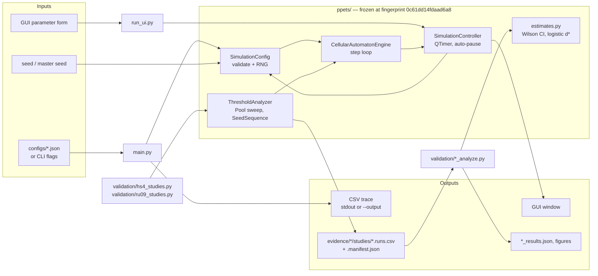

# PPETS Runbook

How to run every part of PPETS, what each path reads and writes, and how to
reproduce the published results. Setup is in [README.md](README.md#setup).
All commands run from the repository root inside the activated `.venv`.

## 1. Execution pathways



There are four entry points. All of them go through `SimulationConfig`, so a
parameter is validated in one place, and every random choice comes from one
seeded generator.

| Entry point | Purpose | Reads | Writes |
| --- | --- | --- | --- |
| `main.py` | One headless run | flags, `--config` JSON | CSV to stdout or `--output` |
| `run_ui.py` | Interactive run (UC01/UC02) | GUI form | nothing on disk |
| `validation/*_studies.py` | Published sweeps | constants in the script (seed, axes, replicates) | `evidence/<stage>/studies/*.csv` + manifests |
| `validation/*_analyze.py`, `*_figures.py` | Estimates and figures from the study CSVs | study CSVs | `*_results.json` + manifest, PNGs |

## 2. Run tiers

| Tier | Commands | Time on the reference machine | Pass condition |
| --- | --- | --- | --- |
| T0 preflight | `python check_env.py` | ~5 s | `READY: 0 failed` |
| T1 smoke | `python main.py`, `python -m pytest -q` | ~25 s | output equals `evidence/hs5/main_expected.txt`; `109 passed` |
| T2 verify | `python validation/run_validation.py`, `python validation/hs5_verify_evidence.py` | ~2.5 min | `12/12`, `24/24` |
| T3 clean room | `python validation/hs5_clean_run.py --validation` | ~4 min + pip | `ALL REQUIRED STEPS PASSED` |
| T4 reproduce one study | `python validation/hs5_clean_run.py --study hs4:L20_s4011` | + ~1 min | `sha256 … reproduced` |
| T5 reproduce everything | section 4 | ~1.5 h with 15 workers | hashes match manifests |

CI ([.github/workflows/ci.yml](.github/workflows/ci.yml)) runs T0 to T2
(without the 2-minute suite) on Windows and Ubuntu.

## 3. Configuration map

| Setting | Where it is set | Read by | Notes |
| --- | --- | --- | --- |
| Model parameters | `SimulationConfig` defaults; `main.py` DEFAULTS, `--config`, flags; GUI form; study scripts | engine | validated in `SimulationConfig.validate()`; CLI adds type checks |
| Run length | `--generations` (CLI); `max_generations` (analyzer); `MAX_GEN` = 150 in study scripts | engine loop | runs also stop at the first extinction |
| Seed (single run) | `seed` | `SimulationConfig.rng` | `None` = random, and the GUI then writes the drawn seed back into the form |
| Master seed (sweep) | `base_config.seed` | `replicate_seed()` | `SeedSequence(master, spawn_key=(i, j, rep))`; independent of worker count |
| Workers | `ThresholdAnalyzer(workers=)`; `WORKERS` = 15 in `validation/hs4_common.py` | sweep | `workers=1` is faster for tiny sweeps (pool start-up ~0.8 s) |
| Qt platform | `QT_QPA_PLATFORM` | Qt | `offscreen` for headless use |
| Clean-run location | `PPETS_CLEAN_BASE` | `hs5_clean_run.py` | keep it short on Windows |

No secrets, credentials or service endpoints exist. `.env` files are not
used, and none is needed.

## 4. Reproduce the published results

The study scripts refuse to run unless `ppets/` matches the fingerprint
recorded in the manifests. Check that first:

```bash
python validation/ru09_studies.py --check-fingerprint     # expect: 0c61dd14fdaad6a8 matches
```

If it does not match, run `git checkout hs4-evidence`. Studies whose CSV
already exists are skipped, so to regenerate one, delete its CSV (or use
`hs5_clean_run.py --study`, which does this in a throwaway copy).

| Step | Command | Published wall time (15 workers) | Output |
| --- | --- | --- | --- |
| HS4 studies (12) | `python validation/hs4_studies.py` | 1,123 s total | `evidence/hs4/studies/` |
| HS4 analysis | `python validation/hs4_analyze.py` | 43 s | `evidence/hs4/hs4_results.json`, figures |
| HS4 benchmark | `python validation/hs4_benchmark.py` | minutes; timings are machine-specific | `evidence/hs4/benchmark.json` |
| RU-09 studies | `python validation/ru09_studies.py` then `python validation/ru09_studies.py L150_s4018` | 2,623 s + 722 s | `evidence/ru09/studies/` |
| RU-09 trajectory | `python validation/ru09_studies.py trajectory` | 58 s | `trajectory_s4050.csv` |
| RU-09 analysis | `python validation/ru09_analyze.py` | 113 s | `evidence/ru09/ru09_results.json` |
| Figures | `pip install -r requirements-optional.txt`, then `python validation/ru09_figures.py` | seconds | `evidence/ru09/figures/` |

Afterwards, `python validation/hs5_verify_evidence.py` tells you whether
every regenerated file is byte-identical (up to line endings) to the
published one. Timings and `benchmark.json` will differ on other hardware.
Results should not differ, because seeds fix every run.

## 5. Outputs and how to read them

| File | Columns / content |
| --- | --- |
| `main.py` CSV | `generation,prey_count,predator_count`; optional last line `Extinction reached at generation N` |
| `*.runs.csv` | one row per run: parameter values, replicate, seed, extinct flag, which species, extinction generation, generations run |
| `*.manifest.json` | output hash, script and command, timestamp, `ppets/` fingerprint, Python/numpy versions, parameters, wall time |
| `evidence/hs5/clean_run_*.json` | each clean-room step with pass/fail, time and detail, plus the venv's `pip freeze` |
| `evidence/hs5/validation/validation_report.txt` | the 12 checks with measured details |

## 6. Packaging and releases

- Graded states are annotated git tags (`hs3-baseline`, `hs4-evidence`;
  proposed for this checkpoint: `hs5-hardening`). `git checkout <tag>` gives
  exactly what was evaluated.
- A source archive without git: `git archive --format=zip -o ppets-hs5.zip hs5-hardening`.
  `check_env.py` will warn that tags are missing, which only matters for
  `--check-fingerprint`.
- No wheel or installer is built. PPETS is run from a checkout, so
  `main.py` and `run_ui.py` find `ppets/` next to them.
- No container image. Docker was not available on the reference machine, so
  a Dockerfile could not be tested; an untested one was deliberately not added.

## 7. External interfaces

| Interface | Used? | Notes |
| --- | --- | --- |
| Web APIs, databases, cloud services | No | Nothing to configure, no rate limits, no mock needed |
| Credentials, `.env` | No | — |
| PyPI (pip) | Setup only | Offline install: `pip download -r requirements-lock.txt -d wheels` on a connected machine, then `pip install --no-index --find-links wheels -r requirements-lock.txt` |
| GitHub | Clone, CI | Public repository; CI needs no secrets |
| File system | Yes | writes only inside the repository (`evidence/`, `experiments/output/`) or where `--output` points |
